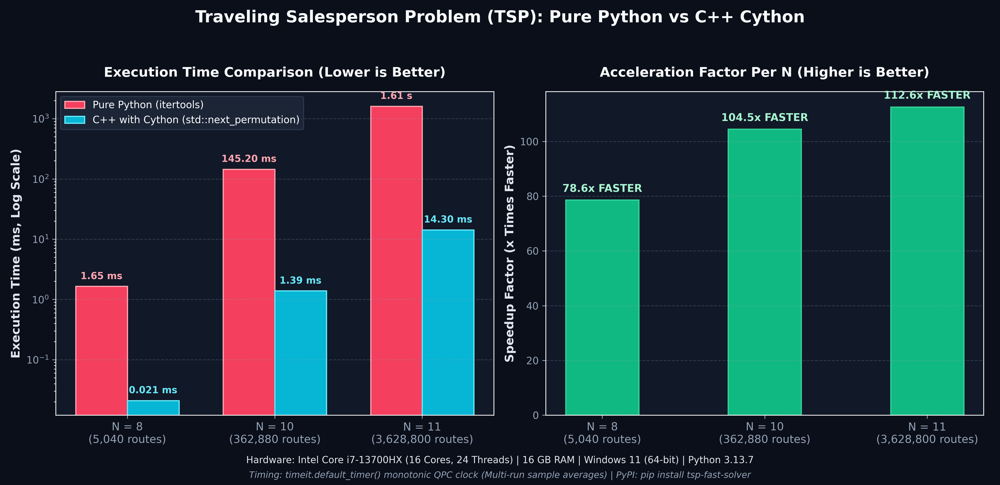

# crispy-cython

[](https://pypi.org/project/tsp-fast-solver/)
[](https://www.python.org/downloads/)
[](LICENSE)

A collection of graph and mathematical algorithms comparing pure Python implementations against native C/C++ accelerated using Cython.

Currently features an exact brute-force solver for the **Traveling Salesperson Problem (TSP)** published on PyPI as [`tsp-fast-solver`](https://pypi.org/project/tsp-fast-solver/).

---

## Benchmark: Pure Python vs C++ (Cython)

Here is a performance comparison for the Traveling Salesperson Problem across different graph sizes:



### Results

| Graph Size ($N$) | Routes $(N-1)!$ | Pure Python | C++ (Cython) | Speedup |
|:---:|:---:|:---:|:---:|:---:|
| $N = 8$ | 5,040 | 1.65 ms | 0.021 ms | **~79x** |
| $N = 10$ | 362,880 | 145.2 ms | 1.39 ms | **~104x** |
| $N = 11$ | 3,628,800 | 1.61 s | 14.3 ms | **~112x** |

**Hardware & Methodology:**
- **CPU**: 13th Gen Intel Core i7-13700HX (16 cores, 24 threads)
- **RAM**: 16 GB DDR5
- **OS**: Windows 11 (64-bit)
- **Python**: 3.13.7
- **Compiler**: Clang / LLVM-MinGW (`-O3 -std=c++17 -static`)
- **Timing**: `timeit.default_timer()` averaging 10 runs for $N=8, 10$ and 3–5 runs for $N=11$.

---

## Why is C++ so much faster here?

1. **Memory layout**: C++ stores the distance matrix in a single contiguous 1D array (`dist_matrix[i * n + j]`), which easily fits into CPU L1/L2 cache. Python lists store pointers to heap-allocated integer objects, causing frequent cache misses.
2. **Zero heap allocation**: The C++ solver uses `std::next_permutation` to mutate city order in-place inside registers and stack memory. Python's `itertools.permutations` creates millions of temporary tuple objects.
3. **No interpreter overhead**: Python must decode bytecode instructions, check types dynamically, and increment reference counts on every single loop iteration. C++ runs straight machine instructions.

---

## Quickstart

### Install from PyPI

```bash
pip install tsp-fast-solver
```

### Example Usage

```python
from tsp_fast_solver import tsp_python, tsp_cython

# 4-city distance matrix
matrix = [
    [0, 10, 15, 20],
    [10, 0, 35, 25],
    [15, 35, 0, 30],
    [20, 25, 30, 0]
]

print("Python result:", tsp_python(matrix))  # 80
print("Cython result:", tsp_cython(matrix))  # 80
```

---

## How It Works

### 1. Python Baseline (`tsp/python_solver/tsp_pure.py`)
Fixes city `0` as the origin and permutes the remaining cities using `itertools.permutations`:

```python
import itertools, math

def tsp_python(dist_matrix):
    n = len(dist_matrix)
    if n <= 1: return 0
    if n == 2: return dist_matrix[0][1] + dist_matrix[1][0]

    min_cost = math.inf
    for perm in itertools.permutations(range(1, n)):
        cost = dist_matrix[0][perm[0]]
        for i in range(len(perm) - 1):
            cost += dist_matrix[perm[i]][perm[i + 1]]
        cost += dist_matrix[perm[-1]][0]
        if cost < min_cost:
            min_cost = cost
    return min_cost
```

### 2. C++ Implementation (`tsp/cpp/tsp.cpp`)
Uses `std::iota` to fill an array with `1` to `n-1`, then loops with `std::next_permutation`:

```cpp
#include "tsp.h"
#include <vector>
#include <algorithm>
#include <climits>
#include <numeric>

int solve_tsp(const std::vector<int>& dist_matrix, int n) {
    if (n <= 1) return 0;
    if (n == 2) return dist_matrix[0 * n + 1] + dist_matrix[1 * n + 0];

    std::vector<int> cities(n - 1);
    std::iota(cities.begin(), cities.end(), 1);

    int min_cost = INT_MAX;
    do {
        int cost = dist_matrix[0 * n + cities[0]];
        for (int i = 0; i < n - 2; ++i) {
            cost += dist_matrix[cities[i] * n + cities[i + 1]];
        }
        cost += dist_matrix[cities[n - 2] * n + 0];
        if (cost < min_cost) min_cost = cost;
    } while (std::next_permutation(cities.begin(), cities.end()));

    return min_cost;
}
```

### 3. Cython Bridge (`tsp/cython_wrapper/tsp_wrapper.pyx`)
Flattens the Python list-of-lists into a C++ `std::vector<int>` and calls the compiled solver:

```cython
from libcpp.vector cimport vector
from tsp_wrapper cimport solve_tsp

def tsp_cython(object distance_matrix):
    cdef int n = len(distance_matrix)
    if n <= 1: return 0

    cdef vector[int] vec
    vec.reserve(n * n)

    cdef int i, j
    for i in range(n):
        row = distance_matrix[i]
        for j in range(n):
            vec.push_back(<int>row[j])

    return solve_tsp(vec, n)
```

---

## When to use Cython (and when not to)

- **Use Cython for**: CPU-bound loops, graph problems, matrix operations, and numerical tasks where Python's dynamic overhead is the main bottleneck.
- **Don't use Cython for**: I/O-bound tasks (network requests, database calls, file reading) where the CPU is mostly waiting, or simple scripts where Python is already fast enough.

---

## Repository Structure

```
crispy-cython/
├── tsp/
│   ├── cpp/                  # tsp.h & tsp.cpp
│   ├── cython_wrapper/       # tsp_wrapper.pxd & tsp_wrapper.pyx
│   ├── python_solver/        # tsp_pure.py
│   ├── tsp_fast_solver/      # PyPI package source
│   ├── tests/                # pytest test suite
│   ├── benchmark.py          # Benchmark runner
│   ├── setup.py              # Build script (-O3 -static)
│   └── pyproject.toml        # Package metadata
├── dijkstra_c_vs_python/     # Dijkstra comparison (C vs Python)
├── tsp_benchmark_comparison.png
├── LICENSE
└── README.md
```

---

## Running Locally

### Benchmark
```bash
cd tsp
python benchmark.py
```

### Tests
```bash
cd tsp
python -m pytest tests/
```

### Build Cython Extension
```bash
cd tsp
python setup.py build_ext --inplace
```

---

## License

MIT License. See [LICENSE](LICENSE) for details.
