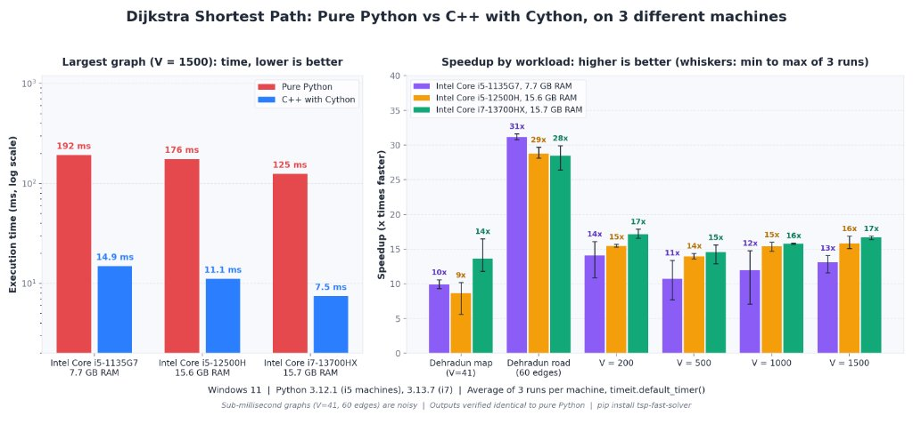

# crispy-cython

[](https://pypi.org/project/tsp-fast-solver/)
[](https://www.python.org/downloads/)
[](LICENSE)
[](https://en.cppreference.com/w/cpp/17)
[](https://cython.org/)

A collection of high-performance graph algorithms comparing **Pure Python** against **Native C/C++** accelerated using **Cython**.

Features two production-grade modules:
1. **Cython C++ Dijkstra Implementation**: Fast matrix and path reconstruction engine featuring a **real-world Dehradun road routing engine** from **UPES Bidholi to Clock Tower (Ghanta Ghar)** with multi-stop optimization, live OpenStreetMap road snapping, liquid glassmorphism, and empirical multi-machine hardware benchmarks.
2. **Traveling Salesperson Problem (TSP)**: Exact factorial brute-force solver published on PyPI as [`tsp-fast-solver`](https://pypi.org/project/tsp-fast-solver/).

---

## Module 1) Cython C++ Dijkstra Implementation

Located in [`dijkstra_c_vs_python/`](dijkstra_c_vs_python/). Solves single-source shortest paths and reconstructs optimal routes on dense matrix graphs and real-world metropolitan networks.

### Cross-Machine Benchmark Evaluation (3 Laptops, 3 Runs Each)



#### Hardware Comparison & Speedup Table

| Graph / Benchmark Tier | Matrix Size ($V^2$) | Intel Core i5-1135G7 (7.7 GB RAM) | Intel Core i5-12500H (15.6 GB RAM) | Intel Core i7-13700HX (15.7 GB RAM) |
| :--- | :---: | :---: | :---: | :---: |
| **Dehradun Map ($V=41$)** | 1,681 cells | **$10\times$ faster** | **$9\times$ faster** | **$14\times$ faster** |
| **Dehradun Road (60 edges)** | 60 edges | **$31\times$ faster** | **$29\times$ faster** | **$28\times$ faster** |
| **Synthetic $V = 200$** | 40,000 cells | **$14\times$ faster** | **$15\times$ faster** | **$17\times$ faster** |
| **Synthetic $V = 500$** | 250,000 cells | **$11\times$ faster** | **$14\times$ faster** | **$15\times$ faster** |
| **Synthetic $V = 1000$** | 1,000,000 cells | **$12\times$ faster** | **$15\times$ faster** | **$16\times$ faster** |
| **Synthetic $V = 1500$** | 2,250,000 cells | $192\,\text{ms} \to 14.9\,\text{ms}$ (**$13\times$**) | $176\,\text{ms} \to 11.1\,\text{ms}$ (**$16\times$**) | $125\,\text{ms} \to 7.5\,\text{ms}$ (**$17\times$**) |

#### Terminal Benchmark Runs (3 Machines, 3 Runs Each)

##### Machine 1: Intel Core i7-13700HX (Vansh)
| Run 1 | Run 2 | Run 3 |
| :---: | :---: | :---: |
|  |  |  |

##### Machine 2: Intel Core i5-1135G7 (Ambrish)
| Run 1 | Run 2 | Run 3 |
| :---: | :---: | :---: |
|  |  |  |

##### Machine 3: Intel Core i5-12500H (Lakshya)
| Run 1 | Run 2 | Run 3 |
| :---: | :---: | :---: |
|  |  |  |

### Real-World Dehradun Routing Engine
- **Origin**: UPES Bidholi Campus (`30.41589° N, 77.96644° E`)
- **Destination**: Clock Tower (Ghanta Ghar), Dehradun (`30.32443° N, 78.04184° E`)
- **Multi-Stop Permutation Solver**: Optimizes intermediate stops (e.g. Indian Oil Petrol Pump, Manduwala Friend's House, The Village Restaurant).
- **Curved GPS Road Geometry**: Snaps lines directly to real OpenStreetMap road curves using live OSRM rather than straight euclidean lines.
- **Interactive Liquid Glass UI**: Translucent glassmorphism with Google Quicksand typography, draggable pins, centered slide-down planner panel, and JSON export.

```bash
# Run web application
python dijkstra_c_vs_python/app.py

# Run Streamlit interface
streamlit run dijkstra_c_vs_python/streamlit_app.py
```

---

## Module 2: Traveling Salesperson Problem (TSP)

Located in `tsp/`. Exact factorial brute-force solver exploring all $(N - 1)!$ closed tours.


### Performance Benchmark (Pure Python vs C++ Cython)

| Graph Size ($N$) | Routes $(N-1)!$ | Pure Python | C++ (Cython) | Speedup |
| :---: | :---: | :---: | :---: | :---: |
| $N = 8$ | 5,040 | 2.1 ms | 0.033 ms | **~66x** |
| $N = 10$ | 362,880 | 149 ms | 1.42 ms | **~105x** |
| $N = 11$ | 3,628,800 | 1.63 s | 14.3 ms | **~114x** |

**Hardware & Methodology:**
- **CPU**: 13th Gen Intel Core i7-13700HX (16 cores, 24 threads)
- **RAM**: 16 GB DDR5
- **OS**: Windows 11 (64-bit)
- **Python**: 3.13.7
- **Compiler**: Clang / LLVM-MinGW (`-O3 -std=c++17 -static`)
- **Timing**: `timeit.default_timer()` monotonic QPC hardware clock.

---

## Why is C++ with Cython So Much Faster?

1. **Memory Layout & Cache Locality**: C++ stores graph matrices and distance tables in contiguous 1D memory buffers (`graph[u * V + v]`). These buffers fit directly into CPU L1/L2 caches, eliminating cache misses. In contrast, Python nested lists contain heap-allocated pointer arrays pointing to boxed integer objects scattered across memory.
2. **Zero Heap Allocation in Inner Loops**: C++ performs in-place array scans with raw pointers (`const int* row = &graph[u * V]`). Python creates temporary iterator and tuple objects that trigger garbage collection overhead.
3. **No Interpreter Overhead**: Python decodes bytecode, checks dynamic types, and increments/decrements reference counts on every cycle. Compiled C++ executes pure machine assembly.

---

## Repository Structure

```
Cython/
├── dijkstra_c_vs_python/               # Module 1: Dijkstra Shortest Path Solver
│   ├── cpp/
│   │   ├── dijkstra.h                  # C++ solver header
│   │   └── dijkstra.cpp                # C++ implementation with path tracking
│   ├── cython_wrapper/
│   │   ├── dijkstra_wrapper.pxd        # Cython declarations
│   │   └── dijkstra_wrapper.pyx        # Cython wrapper
│   ├── python_solver/
│   │   └── dijkstra_pure.py            # Pure Python baseline
│   ├── dijkstra_fast_solver/           # Packaged module
│   ├── dehradun_map/
│   │   ├── dehradun_graph.py           # Real Dehradun road network graph
│   │   └── generate_map.py             # Generates interactive Leaflet HTML map
│   ├── Command prompt test/            # Terminal verification runs (3 runs on 3 laptops)
│   ├── tests/
│   │   └── test_dijkstra.py            # Pytest test suite
│   ├── benchmark.py                    # Dijkstra benchmark script
│   ├── generate_chart.py               # Visual comparison chart generator
│   ├── setup.py                        # Setuptools build script
│   └── pyproject.toml                  # PEP 517 configuration
├── tsp/                                # Module 2: Traveling Salesperson Problem Solver
│   ├── cpp/
│   ├── cython_wrapper/
│   ├── python_solver/
│   ├── tsp_fast_solver/
│   ├── tests/
│   ├── benchmark.py
│   ├── setup.py
│   └── pyproject.toml
├── dehradun_shortest_path.html         # Interactive map (view in browser)
├── dijkstra_benchmark_comparison.png   # Dijkstra performance infographic
├── tsp_benchmark_comparison.png        # TSP performance infographic
├── LICENSE
└── README.md
```

---

## Quick Commands

### 1. Build and Run Dijkstra Solvers
```bash
cd dijkstra_c_vs_python

# Build C++ Cython extension in-place
python setup.py build_ext --inplace

# Run the comprehensive benchmark
python benchmark.py

# Generate the interactive Dehradun map
python dehradun_map/generate_map.py

# Run unit tests
python -m pytest tests/test_dijkstra.py -v

# Package sdist for PyPI
python -m build --sdist --no-isolation
```

### 2. Build and Run TSP Solvers
```bash
cd tsp

# Build Cython extension
python setup.py build_ext --inplace

# Run benchmark
python benchmark.py

# Run unit tests
python -m pytest tests/
```

---

## License
MIT License. See [LICENSE](LICENSE) for details.
