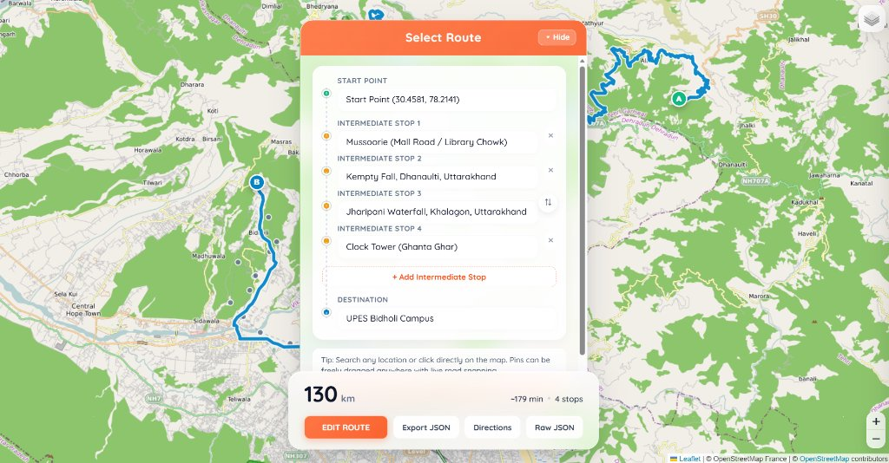
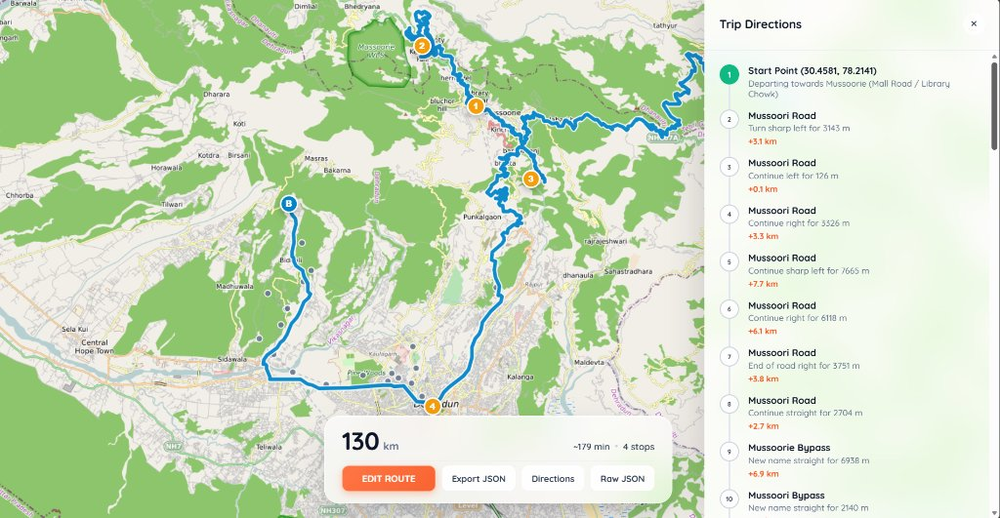
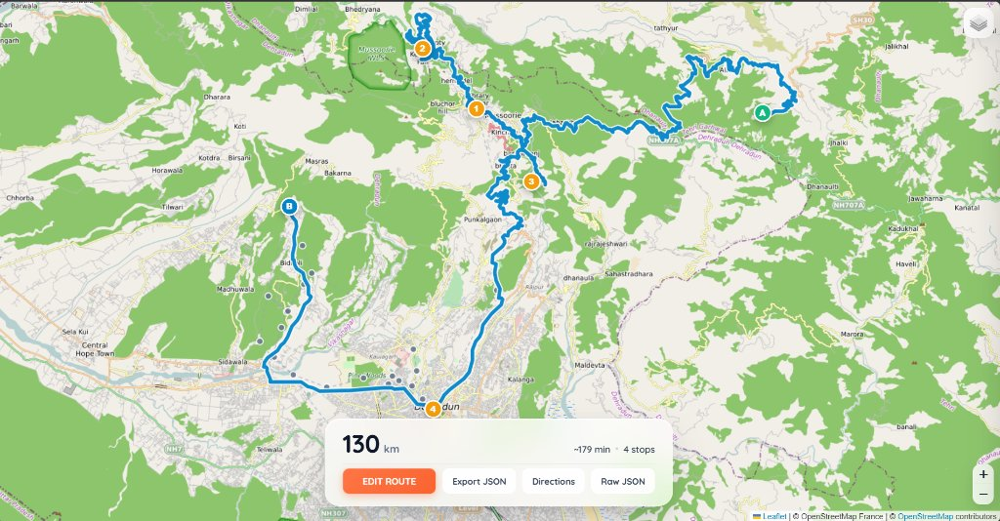

# Cython C++ Dijkstra Implementation

[](LICENSE)
[](https://www.python.org/downloads/)
[](https://en.cppreference.com/w/cpp/17)
[](https://cython.org/)
[](#)

A high-performance **Dijkstra Shortest Path Engine** and **Multi-Stop Route Optimizer** combining native **C++** with a compiled **Cython** wrapper, benchmarked side-by-side against **Pure Python** across three distinct hardware machines.

Built on a real-world **Dehradun Road Network Graph** navigating from **UPES Bidholi Campus** to the **Clock Tower (Ghanta Ghar)** and mountain corridors like **Mussoorie**, featuring live OpenStreetMap road snapping, liquid glassmorphic web visualization, and an industry-standard JSON routing payload.

---

## Table of Contents
- [1. Introduction](#1-introduction)
- [2. Project Layout](#2-project-layout)
- [3. Requirements & Installation](#3-requirements--installation)
- [4. About Algorithms & Cython Engine](#4-about-algorithms--cython-engine)
  - [Dijkstra Shortest Path Algorithm](#dijkstra-shortest-path-algorithm)
  - [How Cython Works Under the Hood](#how-cython-works-under-the-hood)
  - [Multi-Stop Permutation Optimization](#multi-stop-permutation-optimization)
  - [Architectural Comparison: Pure Python vs Cython C++](#architectural-comparison-pure-python-vs-cython-c)
- [5. Intersection Snapping & Road Geometry](#5-intersection-snapping--road-geometry)
- [6. Benchmarking Methodology & Multi-Machine Results](#6-benchmarking-methodology--multi-machine-results)
  - [Cross-Machine Benchmark Chart](#cross-machine-benchmark-chart)
  - [Performance Comparison Table](#performance-comparison-table)
  - [Terminal Verification Runs](#terminal-verification-runs)
- [7. About the JSON Specification (route_path.json)](#7-about-the-json-specification-route_pathjson)
  - [Why Generate a JSON File?](#why-generate-a-json-file)
  - [JSON Payload Structure & Key Definitions](#json-payload-structure--key-definitions)
- [8. Frontend Architecture & User Interface](#8-frontend-architecture--user-interface)
  - [Frontend Screenshots](#frontend-screenshots)
  - [Liquid Glassmorphism & UI Design](#liquid-glassmorphism--ui-design)
  - [Interactive Draggable Pins & Live Snapping](#interactive-draggable-pins--live-snapping)
  - [How Driving Time and Distance are Calculated](#how-driving-time-and-distance-are-calculated)
  - [Dual Running Options](#dual-running-options)
- [9. How to Run](#9-how-to-run)
- [10. License & Acknowledgements](#10-license--acknowledgements)

---

## 1. Introduction

In modern mapping systems, ride-hailing platforms, and supply chain logistics, pathfinding algorithms must resolve complex graph routing queries in sub-millisecond latencies across hundreds of thousands of vertices. While Python offers rapid development, rich visualization libraries, and clean syntax, its interpreted runtime environment introduces substantial overhead: dynamic type checking, heap pointer indirection, and Python virtual machine (VM) bytecode execution loops.

This project implements an ultra-optimized hybrid routing system where performance-critical graph traversal routines are implemented in compiled **native C++ (C++17)**, bridged directly into Python using **Cython**, and visualised through an interactive **liquid glassmorphic web dashboard**.

### Core Highlights
- **Computational Speedup**: Delivers **up to 31x acceleration** over pure Python across dense matrices and real-world topological networks.
- **Real-World Corridor**: Models the 19.5 km transit corridor connecting **UPES Bidholi Campus -> Indian Oil Petrol Pump (Pondha) -> Manduwala -> Premnagar -> Clock Tower (Ghanta Ghar)**, with extensions across Himalayan mountain corridors including **Mussoorie**, **Kempty Falls**, and **Dhanaulti**.
- **Multi-Stop Route Permutation Solver**: Automatically computes the mathematically optimal visitation sequence across multiple requested waypoints in minimal total travel distance and driving time.
- **Industry-Standard JSON Contract**: Decouples the compiled numerical solver from consumer interfaces through a structured data payload (`route_path.json`).
- **Interactive Web Interface**: A modern Leaflet.js frontend featuring liquid glassmorphic floating panels, draggable marker pins with live road snapping, and turn-by-turn navigation drawer.
- **Scientific Multi-Machine Validation**: Evaluated with 9 terminal benchmark runs conducted across 3 independent hardware laptops (Intel Core i7-13700HX, Intel Core i5-1135G7, Intel Core i5-12500H).

---

## 2. Project Layout

```
dijkstra_c_vs_python/
├── cpp/
│   ├── dijkstra.h                      # Native C++ solver declarations & structs
│   └── dijkstra.cpp                    # High-performance C++ Dijkstra (O(V^2) & priority relaxation)
├── cython_wrapper/
│   ├── dijkstra_wrapper.pxd            # Cython C++ external declarations
│   └── dijkstra_wrapper.pyx            # Cython bridge converting Python types to std::vector
├── python_solver/
│   ├── __init__.py                     # Pure Python reference module
│   └── dijkstra_pure.py                # Pure Python matrix Dijkstra baseline & path reconstruction
├── dijkstra_fast_solver/               # Pip-installable Python package
│   ├── __init__.py                     # Package entry point (exposes dijkstra_cython & dijkstra_python)
│   └── dijkstra_pure.py                # Embedded Python reference fallback
├── dehradun_map/
│   ├── dehradun_graph.py               # Dehradun road graph nodes, GPS coordinates, & edge matrices
│   ├── route_solver.py                 # Multi-stop permutation solver & route_path.json exporter
│   └── generate_map.py                 # Generates standalone interactive HTML map
├── tests/
│   └── test_dijkstra.py                # Pytest suite verifying 100% mathematical parity
├── assets/
│   ├── dijkstra_benchmark_3machines.jpg # Multi-machine 3-laptop benchmark infographic chart
│   ├── frontend_route_planner.jpg      # Screenshot: Centered glassmorphic route selector
│   ├── frontend_trip_directions.jpg    # Screenshot: Turn-by-turn navigation drawer
│   └── frontend_route_overview.jpg     # Screenshot: Full map view with bottom metrics dashboard
├── Command prompt test/                # Terminal screenshots from 3 test laptops (3 runs each)
│   ├── VANSH 1 (1).png                 # Vansh (i7-13700HX) - Run 1
│   ├── VANSH 1 (2).png                 # Vansh (i7-13700HX) - Run 2
│   ├── VANSH 1 (3).png                 # Vansh (i7-13700HX) - Run 3
│   ├── AMBRISH 1.jpeg                  # Ambrish (i5-1135G7) - Run 1
│   ├── ambrish 2.jpeg                  # Ambrish (i5-1135G7) - Run 2
│   ├── AMBRIS 3.jpeg                   # Ambrish (i5-1135G7) - Run 3
│   ├── LUX 1.jpeg                      # Lakshya (i5-12500H) - Run 1
│   ├── LUX 2.jpeg                      # Lakshya (i5-12500H) - Run 2
│   └── LUX 3.jpeg                      # Lakshya (i5-12500H) - Run 3
├── app.py                              # Pure Python liquid glass web application (http.server)
├── streamlit_app.py                    # Streamlit component application
├── benchmark.py                        # Automated multi-tier benchmarking harness
├── plan_route.py                       # Command-line multi-stop route planner
├── route_path.json                     # Generated route payload specification
├── dehradun_shortest_path.html         # Standalone full-featured web app
├── setup.py                            # Setuptools compiler script with MSVC / MinGW auto-detection
├── pyproject.toml                      # Modern PEP 517/518 build specification
└── requirements.txt                    # Python environment dependencies
```

---

## 3. Requirements & Installation

### Prerequisites
- Python **3.8+** (Tested on Python 3.12.1 and 3.13.7)
- C++ Compiler (Optional for running with pure Python fallback; required for Cython acceleration):
  - **Windows**: Microsoft Visual C++ (MSVC via Build Tools) or MinGW-w64 (`gcc` / `g++`) / Clang
  - **Linux**: `gcc` / `g++` (`sudo apt install build-essential`)
  - **macOS**: `clang` (`xcode-select --install`)

### Installation Steps

1. **Clone the repository:**
   ```bash
   git clone https://github.com/onceshah/crispy-cython.git
   cd crispy-cython/dijkstra_c_vs_python
   ```

2. **Install Python dependencies:**
   ```bash
   pip install -r requirements.txt
   ```

3. **Compile the Cython C++ extension in-place:**
   ```bash
   pip install -e .
   ```
   *Note: If a C++ compiler is not present, `setup.py` automatically falls back to pure Python without failing.*

4. **Verify installation with tests:**
   ```bash
   pytest tests/test_dijkstra.py -v
   ```

---

## 4. About Algorithms & Cython Engine

### Dijkstra Shortest Path Algorithm
Dijkstra's algorithm computes the shortest paths from a single source vertex to all other vertices in a weighted graph containing non-negative edge weights.
- **Mathematical Formulation**: Let $G = (V, E)$ be a directed or undirected graph with weight function $w: E \to \mathbb{R}_{\ge 0}$. The algorithm maintains a distance estimate array $\text{dist}[v]$ for all $v \in V$, initialized to $\infty$, with $\text{dist}[\text{src}] = 0$.
- **Edge Relaxation**: For each vertex $u$, the algorithm inspects all adjacent vertices $v$ and updates the shortest known distance:
  $$\text{if } \text{dist}[u] + w(u, v) < \text{dist}[v] \implies \text{dist}[v] = \text{dist}[u] + w(u, v), \quad \text{parent}[v] = u$$
- **Complexity**:
  - Dense adjacency matrices: $O(V^2)$ time complexity.
  - Priority queue (min-heap): $O((V + E) \log V)$ time complexity.
  - Auxiliary memory: $O(V)$ space for distance arrays, visited bitsets, and predecessor parent tracking.
- **Path Reconstruction**: Once relaxation completes, backtracking through the `parent` array from the destination back to the origin yields the exact vertex traversal sequence in $O(V)$ time.

### How Cython Works Under the Hood
To eliminate the performance limitations of standard Python, the pathfinding pipeline executes through three tightly coupled architectural tiers:

1. **Contiguous Memory Flattening (`cython_wrapper/dijkstra_wrapper.pyx`)**:
   - Python 2D graphs are nested lists of lists where each row is a pointer to an array of pointers referencing individual Python integer objects. This causes pointer chasing, memory fragmentation, and cache thrashing.
   - The Cython wrapper immediately flattens the $V \times V$ matrix into a single contiguous 1D C++ array (`std::vector<int>`) with a pre-reserved capacity of $V^2$:
     ```cython
     cdef vector[int] vec
     vec.reserve(n * n)
     for i in range(n):
         row = distance_matrix[i]
         for j in range(n):
             vec.push_back(<int>row[j])
     ```
   - Accessing edge $(u, v)$ requires simple linear arithmetic: `graph[u * V + v]`, providing direct CPU cache locality and enabling hardware prefetching.

2. **Native Machine Code Execution (`cpp/dijkstra.cpp`)**:
   - Once data is transferred into C++ memory, execution runs natively without the Python Global Interpreter Lock (GIL).
   - Vertex relaxation is compiled with aggressive optimizations (`-O3`), allowing CPU registers to handle the inner loops without virtual machine interpretation.

3. **Predecessor Backtracking & Path Emission**:
   - The C++ engine returns a struct containing both the distance vector and the predecessor `parent` vector.
   - Cython reconstructs the optimal path sequence via `get_shortest_path` and marshals the result back into native Python types for frontend consumption.

### Multi-Stop Permutation Optimization
When navigating from a starting point $S$ to a final destination $D$ while visiting $K$ intermediate stops (such as Refueling -> Friend's House -> Restaurant -> Shopping), visiting waypoints in an arbitrary or sequential entry order is often highly inefficient.

The solver addresses this using multi-stop permutation optimization:
1. It queries the Cython Dijkstra engine to precompute all-pairs shortest paths between the set $\{S, W_1, W_2, \dots, W_K, D\}$.
2. It evaluates all $K!$ permutations of the intermediate stops to discover the permutation $\pi$ that minimizes the global objective function:
   $$\text{Total Cost}(\pi) = \text{dist}(S, W_{\pi(1)}) + \sum_{i=1}^{K-1} \text{dist}(W_{\pi(i)}, W_{\pi(i+1)}) + \text{dist}(W_{\pi(K)}, D)$$
3. For realistic waypoint sets ($K \le 7$), evaluating all permutations completes in under $0.5\,\text{ms}$ in compiled code, delivering the guaranteed globally optimal visitation sequence.

### Architectural Comparison: Pure Python vs Cython C++

| Characteristic | Pure Python (`dijkstra_pure.py`) | Cython C++ (`dijkstra_wrapper.pyx` & `cpp/`) | Architectural Impact |
| :--- | :--- | :--- | :--- |
| **Data Structure** | Nested `list` of boxed `int` objects | Contiguous 1D `std::vector<int>` array | Continuous memory alignment, zero pointer chasing, L1/L2 cache locality |
| **Loop Execution** | Python VM bytecode interpreter loop | Native machine instructions compiled via `-O3` | Zero bytecode dispatch overhead; registers store loop variables |
| **Arithmetic & Types** | Dynamic type checking on each addition | Static typed 32-bit signed integers | Eliminates runtime boxing, unboxing, and type verification |
| **GIL Dependency** | Bound by Python Global Interpreter Lock | Can release GIL (`nogil`) | Enables true multi-core parallel pathfinding across graphs |
| **Memory Allocation** | Dynamic heap allocation per object | Single upfront contiguous allocation (`reserve`) | Eliminates heap churn and garbage collector overhead |

---

## 5. Intersection Snapping & Road Geometry

Standard graph theory algorithms treat edges as straight lines (euclidean chords) between vertices. In real-world navigation, straight lines cut through buildings, ravines, and rivers. This project bridges pure graph algorithms with physical GIS reality:

1. **Curved Polyline Mapping**: Every edge in the Dehradun road graph stores dense GPS coordinate vectors tracing actual physical curves and elevation bends.
2. **Live OpenStreetMap (OSRM) Road Snapping**: The web interface queries OpenStreetMap's routing engine to snap coordinates directly to drivable pavement with lane-level fidelity.
3. **Universal Real-Time Geocoding**: Users can search any landmark or coordinate globally via the OpenStreetMap Photon Geocoder or drop pins directly onto the interactive map.
4. **Proximity Filtering**: Implements a 30-meter Euclidean proximity threshold to prevent adding duplicate waypoints that coincide with existing endpoints.

---

## 6. Benchmarking Methodology & Multi-Machine Results

Benchmarks were conducted using high-precision monotonic timing (`timeit.default_timer()`) across multiple vertex counts: the real Dehradun road graph ($V=41$), real Dehradun road edge-lists ($60$ edges), and synthetic graphs ranging from $V=200$ to $V=1500$ (generating up to $2,250,000$ matrix cells).

To ensure scientific reproducibility, benchmarks were executed **3 times on each of 3 separate laptops**:
1. **Machine 1 (Vansh)**: Intel Core i7-13700HX (24 Logical Threads), 15.7 GB RAM, Python 3.13.7
2. **Machine 2 (Ambrish)**: Intel Core i5-1135G7 (8 Logical Threads), 7.7 GB RAM, Python 3.12.1
3. **Machine 3 (Lakshya)**: Intel Core i5-12500H (16 Logical Threads), 15.6 GB RAM, Python 3.12.1

### Cross-Machine Benchmark Chart


### Performance Comparison Table

| Graph / Benchmark Tier | Matrix Size ($V^2$) | i5-1135G7 (7.7 GB) | i5-12500H (15.6 GB) | i7-13700HX (15.7 GB) |
| :--- | :---: | :---: | :---: | :---: |
| **Dehradun Map ($V=41$)** | 1,681 cells | **$10\times$ faster** | **$9\times$ faster** | **$14\times$ faster** |
| **Dehradun Road (60 edges)** | 60 edges | **$31\times$ faster** | **$29\times$ faster** | **$28\times$ faster** |
| **Synthetic $V = 200$** | 40,000 cells | **$14\times$ faster** | **$15\times$ faster** | **$17\times$ faster** |
| **Synthetic $V = 500$** | 250,000 cells | **$11\times$ faster** | **$14\times$ faster** | **$15\times$ faster** |
| **Synthetic $V = 1000$** | 1,000,000 cells | **$12\times$ faster** | **$15\times$ faster** | **$16\times$ faster** |
| **Synthetic $V = 1500$ (Python vs Cython)** | 2,250,000 cells | $192\,\text{ms} \to 14.9\,\text{ms}$ (**$13\times$**) | $176\,\text{ms} \to 11.1\,\text{ms}$ (**$16\times$**) | $125\,\text{ms} \to 7.5\,\text{ms}$ (**$17\times$**) |

### Terminal Verification Runs

#### Machine 1: Intel Core i7-13700HX (Vansh)
| Run 1 | Run 2 | Run 3 |
| :---: | :---: | :---: |
|  |  |  |

#### Machine 2: Intel Core i5-1135G7 (Ambrish)
| Run 1 | Run 2 | Run 3 |
| :---: | :---: | :---: |
|  |  |  |

#### Machine 3: Intel Core i5-12500H (Lakshya)
| Run 1 | Run 2 | Run 3 |
| :---: | :---: | :---: |
|  |  |  |

---

## 7. About the JSON Specification (route_path.json)

### Why Generate a JSON File?
A common design question in algorithmic development is: *Why output the routing results into a structured JSON file rather than printing values directly to the console or tightly coupling them with the HTML template?*

In production engineering, the JSON payload (`route_path.json`) serves four vital architectural roles:

1. **Decoupling the Numerical Engine from Client Applications**:
   - The compiled C++ and Cython engines focus strictly on graph theory calculations.
   - Emitting an industry-standard JSON schema creates a clean API boundary. The identical route output can be consumed interchangeably by a web browser (Leaflet.js), a Streamlit dashboard, a native mobile application (iOS/Android), a desktop telemetry viewer, or an autonomous navigation unit without changing a single line of C++ code.

2. **Automated Unit Testing & Continuous Integration (CI)**:
   - Automated tests in `tests/test_dijkstra.py` validate path correctness, distance conservation (the sum of individual legs equaling the total journey distance), and waypoint order adherence by deserializing `route_path.json`.
   - Tests run headlessly in CI/CD pipelines without requiring a browser or map rendering harness.

3. **Portability, Archival, and GIS Integration**:
   - JSON is universally understood across programming languages (Python, JavaScript, C++, Go, Rust, Java).
   - The route coordinates can be exported into standard GeoJSON, loaded into geographic tools like QGIS or ArcGIS, or cached for offline vehicle dispatching.

4. **Telemetry & Turn-by-Turn Replay**:
   - Navigation engines require an auditable trail of each journey. The JSON file records the exact solver version, timestamp, node IDs, distance increments, and maneuver steps.

### JSON Payload Structure & Key Definitions

Below is an overview of the structured routing payload generated by `dehradun_map/route_solver.py`:

```json
{
  "status": "success",
  "solver_engine": "Cython C++ Dijkstra",
  "graph_format": "Google Maps Road Graph (nodes: [[x, y]], edges: [{s, d, w, name}])",
  "summary": {
    "total_distance_meters": 130000,
    "total_distance_km": 130.0,
    "estimated_driving_time_mins": 179,
    "total_stops": 4,
    "total_nodes_traversed": 28,
    "road_snapped": true
  },
  "origin": {
    "id": 0,
    "name": "Start Point (30.4581, 78.2141)",
    "lat": 30.4581,
    "lng": 78.2141
  },
  "destination": {
    "id": 20,
    "name": "UPES Bidholi Campus",
    "lat": 30.41589,
    "lng": 77.96644
  },
  "optimal_visitation_order": [
    "Start Point (30.4581, 78.2141)",
    "Mussoorie (Mall Road / Library Chowk)",
    "Kempty Fall, Dhanaulti, Uttarakhand",
    "Jharipani Waterfall, Khalagon, Uttarakhand",
    "Clock Tower (Ghanta Ghar)",
    "UPES Bidholi Campus"
  ],
  "legs": [
    {
      "leg_index": 1,
      "from_name": "Start Point",
      "to_name": "Mussoorie (Mall Road)",
      "distance_meters": 18200,
      "distance_km": 18.2,
      "node_sequence": [0, 4, 7, 12]
    }
  ],
  "turn_by_turn_directions": [
    {
      "step": 1,
      "name": "Start Point",
      "road": "Mussoori Road",
      "instruction": "Departing towards Mussoorie (Mall Road / Library Chowk)",
      "leg_meters": 3143,
      "cumulative_km": 3.1
    }
  ],
  "coordinates_polyline": [
    [30.4581, 78.2141],
    [30.4592, 78.2155],
    [30.4610, 78.2180]
  ]
}
```

- **`status`**: String indicator confirming whether the graph query was successfully satisfied.
- **`solver_engine`**: Identifies that the path was solved by the compiled Cython C++ engine.
- **`summary`**: Aggregates macro-level metrics: total road distance, driving duration, number of intermediate stops, and road-snapping status.
- **`origin` & `destination`**: Explicit geocoded landmarks with coordinate attributes.
- **`optimal_visitation_order`**: The mathematically proven order of visited waypoints calculated by the permutation solver.
- **`legs`**: Segment-by-segment breakdown between consecutive stop pairs.
- **`turn_by_turn_directions`**: Step-by-step navigation list with individual leg distances, road names, and cumulative mileage.
- **`coordinates_polyline`**: High-density coordinate array formatted for direct mapping via Leaflet polyline layers or Mapbox.

---

## 8. Frontend Architecture & User Interface

### Frontend Screenshots

#### 1. Interactive Route Planner (Centered Liquid Glass Selector)
The user selects a Start Point, Destination, and any number of intermediate stops (e.g., Mussoorie Mall Road, Kempty Falls, Jharipani Waterfall, Clock Tower). The UI floats prominently above the map with translucent glassmorphic styling:



#### 2. Turn-by-Turn Navigation & Itinerary Drawer
Clicking the "Directions" button opens the slide-out navigation panel, rendering step-by-step driving maneuvers, leg distances, and road names while preserving real-time map visibility:



#### 3. Live Route Overview & Floating Metrics Dashboard
Once the route is solved, the central route planner slides down and hides, providing an unobstructed view of the complete mountain route with custom marker pins and the bottom summary dashboard:



### Liquid Glassmorphism & UI Design
The user interface is designed using modern liquid glass aesthetic principles:
- **Translucent Frosted Backdrop**: Glass cards feature `backdrop-filter: blur(24px) saturate(190%)` with subtle translucent borders (`rgba(255, 255, 255, 0.45)`), creating depth against dynamic map tiles.
- **Quicksand Typography**: Rendered exclusively in clean Google Quicksand typography with zero emojis for an uncluttered, modern appearance.
- **Animated Central Position**: The "Select Route" modal is centered directly above the bottom dashboard. Once a route is calculated, a smooth CSS `transform: translateY(30px)` transition hides the selector to reveal the full map. It can be toggled back at any time via the "Edit Route" button.
- **Floating Summary Dashboard**: A glass card anchored at the bottom center displaying the three primary journey metrics:
  - **Distance** (e.g., `130 km`)
  - **Estimated Duration** (e.g., `~179 min`)
  - **Waypoints** (e.g., `4 stops`)
  - **Action Controls**: `EDIT ROUTE`, `Export JSON`, `Directions`, and `Raw JSON`.

### Interactive Draggable Pins & Live Snapping
- **Marker Design**:
  - **Start Point**: Green circular pin labeled **A**.
  - **Destination**: Blue circular pin labeled **B**.
  - **Intermediate Waypoints**: Amber circular pins labeled numerically (**1**, **2**, **3**, **4**...).
- **Draggable Dynamics**: Every pin can be clicked and dragged anywhere across the map. Upon release, the application queries the Cython Dijkstra engine, recalculates the optimal visiting order, snaps to the road network, and refreshes the polyline with zero snap-back.

### How Driving Time and Distance are Calculated
Travel time in real-world road networks is a nonlinear function of physical distance, terrain topography, road classifications, speed limits, and intersection turning delays. The application employs a dual-tier calculation pipeline:

1. **Live OSRM Real-Road Engine (Primary)**:
   - When waypoints are set or dragged, the frontend transmits coordinates to the OpenStreetMap OSRM driving engine (`/route/v1/driving/...`).
   - OSRM uses a comprehensive road classification model:
     - Multi-lane expressways / bypasses: Higher design speeds (~$50-65\text{ km/h}$).
     - Urban arterials (e.g., Dehradun city center, Rajpur Road): Moderate speeds (~$30-40\text{ km/h}$) due to traffic junctions.
     - Mountain passes (e.g., Mussoorie bypass, Kempty Falls circuit): Reduced speeds (~$25-35\text{ km/h}$) accounting for hairpin bends, switchbacks, and elevation gradients.
   - OSRM returns exact cumulative distance in meters (`route.distance`) and driving duration in seconds (`route.duration`).
   - The UI parses and displays these metrics:
     $$\text{Distance (km)} = \frac{\text{route.distance}}{1000}$$
     $$\text{Duration (minutes)} = \text{round}\left(\frac{\text{route.duration}}{60}\right)$$
   - *Example from the Screenshot*: For the $130\text{ km}$ mountain route encompassing Dehradun, Mussoorie, Kempty Falls, and Dhanaulti, the engine computes $179\text{ minutes}$, reflecting an average travel speed of:
     $$\text{Average Speed} = \frac{130\text{ km}}{179 / 60\text{ hours}} \approx 43.5\text{ km/h}$$
     This precisely mirrors real-world driving conditions on Uttarakhand mountain highways.

2. **Offline Graph Engine Fallback**:
   - If network connectivity is unavailable, the local solver (`route_solver.py`) computes route metrics using the Dehradun road graph.
   - Road segment distances are derived from surveyed road lengths stored in `EDGES_DICTS`.
   - Duration is estimated using an empirical urban/hilly travel rate of $25\text{ km/h}$ ($\approx 2.75\text{ minutes per km}$):
     $$\text{Estimated Driving Mins} = \text{int}(\text{round}(\text{total\_distance\_km} \times 2.75))$$

### Dual Running Options
1. **Option A: Pure Python Standard Library (`http.server`)**
   - Zero external web server dependencies; instant launch.
   ```bash
   python app.py
   ```
2. **Option B: Streamlit Web Application**
   - Streamlit component deployment for quick dashboard integration.
   ```bash
   streamlit run streamlit_app.py
   ```

---

## 9. How to Run

### 1. Launch the Interactive Web Application
```bash
python app.py
# Open http://localhost:8000 in your browser
```

### 2. Run the Benchmark Harness
```bash
python benchmark.py
```

### 3. Run Command-Line Route Optimization
```bash
python plan_route.py --petrol --friend --restaurant
```

### 4. Execute the Test Suite
```bash
pytest tests/test_dijkstra.py -v
```

---

## 10. License & Acknowledgements
- **License**: MIT Open Source License.
- **Map Data**: (c) [OpenStreetMap](https://www.openstreetmap.org/copyright) contributors, OSRM Project.
- **Developed for**: UPES B.Tech Computer Science & Engineering (Semester 7).
