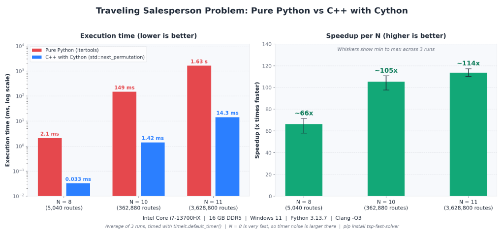

# tsp-fast-solver: High-Performance C++ TSP Solver Wrapped in Cython

[](https://opensource.org/licenses/MIT)
[](https://www.python.org/downloads/)
[](https://en.cppreference.com/w/cpp/17)
[](https://cython.org/)

An ultra-optimized brute-force solver for the **Traveling Salesperson Problem (TSP)** implemented in native **C++**, wrapped and exposed to Python via **Cython**, with a side-by-side **Pure Python** reference implementation.

---

## The Challenge

Graphs are fundamental data structures used to model transportation networks, routing topologies, and relational systems. The **Traveling Salesperson Problem (TSP)** is an NP-Hard problem:
> *Given a list of cities and the distances between each pair of cities, what is the shortest possible route that visits each city exactly once and returns to the origin city?*

Because the number of candidate tours scales factorially:
$$\text{Possible Closed Tours} = (N - 1)!$$

A brute-force search quickly overwhelms dynamic interpreted languages like Python due to bytecode evaluation overhead, dynamic typing, and boxing/unboxing objects. In production engineering, the performance-critical core is implemented in compiled C++ and bridged seamlessly to Python via Cython.

### Real-World Applications
- **Logistics & Fleet Dispatch**: Minimizing delivery fleet mileage to save millions in fuel and vehicle wear.
- **Hardware Circuit Manufacturing**: Robotic arm path optimization when drilling thousands of micro-holes on printed circuit boards (PCBs).
- **Computational Genomics**: DNA fragment assembly and sequencing.

---

## Project Architecture

The codebase cleanly decouples native C++ algorithms, Cython interfacing definitions, pure Python baseline implementations, and packaging configuration:

```
Graph/
├── cpp/
│   ├── tsp.h               # Native C++ solver declaration
│   └── tsp.cpp             # Native C++ brute-force implementation using std::next_permutation
├── cython_wrapper/
│   ├── tsp_wrapper.pxd     # Cython external C++ signature declarations
│   └── tsp_wrapper.pyx     # Cython bridge converting Python 2D lists to std::vector<int>
├── python_solver/
│   ├── __init__.py         # Python solver module entry point
│   └── tsp_pure.py         # Pure Python baseline using itertools.permutations
├── tsp_fast_solver/        # Pip-installable Python package
│   ├── __init__.py         # Unified API exposing tsp_python & tsp_cython
│   └── tsp_pure.py         # Packaged pure Python solver
├── tests/
│   └── test_tsp.py         # Pytest verification and edge-case unit tests
├── benchmark.py            # Automated performance benchmarking & verification suite
├── tsp_wrapper.py          # Top-level module shim for backward compatibility
├── setup.py                # Setuptools compilation and extension build script
├── pyproject.toml          # PEP 517 / PEP 621 build configuration
├── .gitignore              # Ignores build artifacts, object files, and compiled binaries
└── README.md               # Documentation and benchmark results
```

---

## Algorithm Implementations

### 1. Pure Python Solver (`tsp_python`)
- Location: `python_solver/tsp_pure.py`
- Algorithm: Fixes city `0` as the origin and generates all $(N - 1)!$ permutations of remaining cities $\{1, 2, \dots, N-1\}$ using Python's standard `itertools.permutations`.
- Accumulates distance for each cycle $0 \to p_1 \to p_2 \dots \to p_{N-1} \to 0$ and tracks the minimum cost.

### 2. Native C++ Solver (`solve_tsp`)
- Location: `cpp/tsp.h`, `cpp/tsp.cpp`
- Algorithm: Populates a contiguous `std::vector<int>` with $\{1, 2, \dots, N-1\}$ and iteratively generates lexicographical permutations via `std::next_permutation`.
- Operates on a 1D flattened contiguous array for optimal cache locality ($O(1)$ memory overhead, zero dynamic heap allocations in inner loop).

### 3. Cython Bridging Wrapper (`tsp_wrapper`)
- Location: `cython_wrapper/tsp_wrapper.pxd`, `cython_wrapper/tsp_wrapper.pyx`
- Converts incoming Python list-of-lists to a contiguous 1D `std::vector<int>` in $O(N^2)$ time once, releases/minimizes Python interpreter overhead, calls compiled C++ `solve_tsp`, and returns the optimal cost integer.

---

## Benchmark Results



Benchmarked on **Python 3.13.7 (64-bit)** with random symmetric distance matrices (edge weights $10 \le w \le 100$):

| Graph Size ($N$) | Routes $(N-1)!$ | Expected Python Time | Expected Cython Time | Recorded Python Time | Recorded Cython Time | Speedup Factor |
|:----------------:|:---------------:|:--------------------:|:--------------------:|:--------------------:|:--------------------:|:--------------:|
| **$N = 8$**      | 5,040           | $< 0.1\,\text{s}$    | Instant              | **$2.1\,\text{ms}$** | **$0.033\,\text{ms}$**| **$\sim 66\times$** |
| **$N = 10$**     | 362,880         | $\sim 1 - 2\,\text{s}$| $< 0.05\,\text{s}$   | **$149\,\text{ms}$** | **$1.42\,\text{ms}$** | **$\sim 105\times$** |
| **$N = 11$**     | 3,628,800       | $\sim 15 - 30\,\text{s}$| $\sim 0.5\,\text{s}$| **$1.63\,\text{s}$** | **$14.3\,\text{ms}$** | **$\sim 114\times$** |

> **Key Takeaway**: At $N = 11$, Cython + C++ delivers a **$\sim 114\times$ speedup**, reducing computational runtime from 1.63 seconds down to 14.3 milliseconds.

### Why is C++ with Cython so much faster?
1. **Zero Interpreter Overhead**: Python's iteration loops involve dynamic dispatch, reference counting, and bytecode instruction decoding on every step. C++ executes compiled machine code.
2. **Cache Locality**: 1D contiguous vector access (`dist_matrix[i * n + j]`) fits within CPU L1/L2 caches, eliminating cache misses.
3. **In-Place Permutation**: `std::next_permutation` modifies an integer array in place with minimal swaps and zero memory allocations, whereas Python creates tuple objects for permutations.
4. **Compiler Optimization**: C++ compiler vectorization (`-O3`) optimizes inner loop calculations.

---

## Quickstart & Usage

### 1. Build In-Place Locally
```bash
python setup.py build_ext --inplace
```

### 2. Run the Benchmark
```bash
python benchmark.py
```

### 3. Run Unit Tests
```bash
python -m pytest tests/
```

### 4. Example Python Code
```python
from tsp_fast_solver import tsp_python, tsp_cython

# Define a 4-city distance matrix
dist_matrix = [
    [0, 10, 15, 20],
    [10, 0, 35, 25],
    [15, 35, 0, 30],
    [20, 25, 30, 0]
]

# Calculate shortest tour cost
min_cost_py = tsp_python(dist_matrix)
min_cost_cy = tsp_cython(dist_matrix)

print(f"Optimal TSP Cost (Python): {min_cost_py}")  # Output: 80
print(f"Optimal TSP Cost (Cython): {min_cost_cy}")  # Output: 80
```

---

## Packaging and PyPI Distribution

### 1. Building Source Distribution (sdist)
As specified in PEP 517 / PEP 621, build the source distribution using `build`:
```bash
# Upgrade build tool
python -m pip install --upgrade build

# Generate source distribution (.tar.gz)
python -m build --sdist
```
This produces `dist/tsp_fast_solver-0.1.0.tar.gz` containing C++ sources, headers, and Cython code ready for any machine to compile during `pip install`.

### 2. Uploading to PyPI via Twine
```bash
# Install Twine
python -m pip install --upgrade twine

# Upload to PyPI (or TestPyPI)
python -m twine upload dist/*
```
- **Username**: `__token__`
- **Password**: `<Your-PyPI-API-Token>`

*(For testing without modifying production PyPI, use TestPyPI: `python -m twine upload --repository testpypi dist/*`)*

### 3. Verifying Installation
```bash
# Install from PyPI
pip install tsp-fast-solver

# Test installation in Python
python -c "import tsp_fast_solver; print('Success!')"
```

---

## License
This project is licensed under the MIT License.
